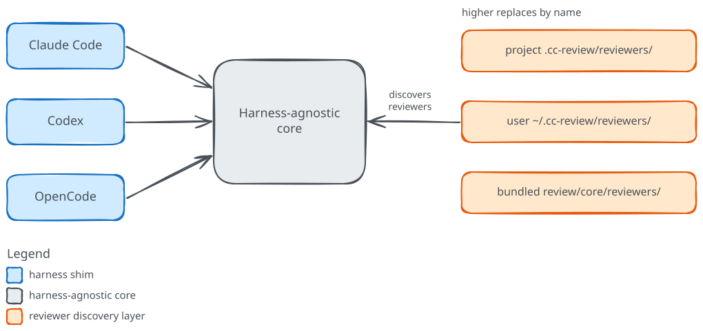

# cc-review Guide

<!-- Sources:
cc-review:README.md:3-6
cc-review:README.md:9-13
cc-review:README.md:23-61
cc-review:README.md:329-362
cc-review:README.md:366-378
cc-review:review/core/scripts/discover-reviewers.sh:717-766
cc-review:review/core/reviewers/greptile/reviewer.md:43-53
cc-review:review/core/agents/meta-skeptic.md:17-26,56-62,85-87
url:https://code.claude.com/docs/en/overview
url:https://developers.openai.com/codex
url:https://opencode.ai/docs/
url:https://www.coderabbit.ai/cli
url:https://docs.github.com/en/copilot/how-tos/copilot-cli
url:https://developers.openai.com/codex/cli
url:https://www.greptile.com/cli
-->

cc-review runs a panel of focused code-review agents, together with external review tools, over a set of changes. It merges their findings, removes the duplicates, filters what is left through two meta-review critics, fixes the Critical and Important issues and re-reviews them, and hands you one report.

That report is the outcome. The problem it addresses is the noise of ordinary AI code review: a single reviewer tends to leave a long list of comments, many of them low-confidence or already handled in the code, and running several review tools by hand means reading and reconciling each one yourself. cc-review does that reconciliation for you and reports the issues worth acting on.

## What the parts are

**cc-review** is a plugin that dispatches specialized code-review agents at your changes, merges and de-duplicates their findings with those of external tools, and runs an autonomous fix loop on the Critical and Important issues before showing you the report.

### The harnesses

A harness is an AI coding agent that runs in your terminal, editor, or desktop and carries out coding tasks from plain-language instructions. cc-review installs into three of them as a plugin, and each harness reads its own manifest and ignores the others.

- [Claude Code](https://code.claude.com/docs/en/overview) is Anthropic's coding agent for the terminal, IDE, and desktop.
- [Codex](https://developers.openai.com/codex) is OpenAI's coding agent.
- [OpenCode](https://opencode.ai/docs/) is an open-source coding agent for the terminal.

### The external review tools

cc-review can also call external, command-line review tools and fold their output into the same report. It runs each one as a "command reviewer", reads the findings it prints, and merges them with the agents' findings.

- [CodeRabbit](https://www.coderabbit.ai/cli) is an AI code review CLI, run by default.
- [GitHub Copilot](https://docs.github.com/en/copilot/how-tos/copilot-cli) is GitHub's AI coding assistant; its command-line tool contributes review findings, and cc-review leaves it off by default.
- [Codex CLI](https://developers.openai.com/codex/cli) is OpenAI's Codex agent run as a reviewer, on by default.
- [Greptile](https://www.greptile.com/cli) is a codebase-aware code review CLI, off by default.

> [!NOTE]
> Codex shows up in both lists. As a harness it is the coding agent you install cc-review into; as Codex CLI it is one of the external reviewers that cc-review calls and merges with the rest.

## How the parts fit

cc-review keeps one harness-agnostic core and adds a thin manifest for each harness. The core holds the review logic; a manifest only tells its harness how to find and run that core, so a review behaves the same way whichever harness you start it from.

The review command carries no built-in list of reviewers. On every run, cc-review scans three layers and runs the reviewers it finds: your project's `.cc-review/reviewers/`, your personal `~/.cc-review/reviewers/`, and the reviewers bundled with the plugin. When a name appears in more than one layer, the higher layer wins, so you can add a reviewer or replace a bundled one without touching the core.

## Why run them together

Several focused reviewers and external tools from more than one vendor all read one change, and their results come back as a single filtered verdict rather than four separate comment streams. You see fewer, higher-confidence issues, and the Critical and Important ones are already fixed wherever cc-review could fix them.

## Status and limits

cc-review is at version <!-- guide:attr cc-review-version -->1.4.0<!-- /guide:attr -->. The external review tools are optional: cc-review runs each one only when its command-line tool is installed and enabled, and it ships with GitHub Copilot and Greptile turned off. Greptile also needs the repository connected to a Greptile organization, and it spends credits on every run (a base review costs one), which is why it stays off until you enable it. The Skeptic, one of the two meta-review critics, re-reads each finding against the code and rules it a false positive only when it can cite code that disproves it. When it cannot evaluate a finding, it keeps the finding, so it rarely drops one outright.

## Where to go next

- Developer: start with [Using cc-review](using/index.md) to install the plugin and run your first review.
- Plugin author: go to [Extending cc-review](extending/index.md) to add your own reviewer or override a bundled one.
- To follow a review run from changes to report, read [How it works](how-it-works/index.md).
- For commands, configuration, and the finding schema, see the [Reference](reference/index.md).

> [!NOTE]
> This guide was verified against cc-review <!-- guide:attr cc-review-commit-short -->37efe88<!-- /guide:attr --> (version <!-- guide:attr cc-review-version -->1.4.0<!-- /guide:attr -->), captured <!-- guide:attr baseline-date -->2026-11-05<!-- /guide:attr -->.
