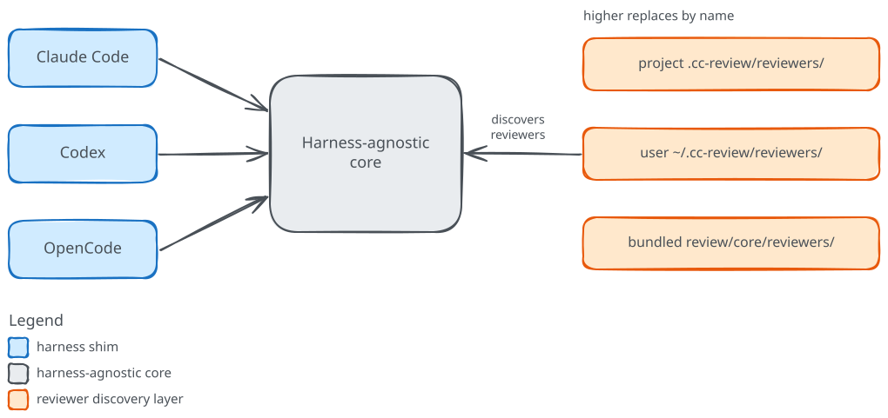

# cc-review Guide

<!-- Sources:
cc-review:README.md:3-7
cc-review:README.md:9-15
cc-review:README.md:24-74
cc-review:README.md:148
cc-review:README.md:186
cc-review:README.md:236
cc-review:README.md:249
cc-review:README.md:255
cc-review:README.md:261-270
cc-review:README.md:347-380
cc-review:README.md:392-396
cc-review:docs/extras/presentation/slides/04-panel-argues.md:24,30
cc-review:docs/extras/presentation/brainstorm.md:129,135
cc-review:review/core/commands/review.md:815-936
cc-review:review/core/scripts/discover-reviewers.sh:717-766
cc-review:review/core/reviewers/greptile/reviewer.md:43-53
cc-review:review/core/agents/meta-skeptic.md:17-26,56-62,85-87
url:https://docs.github.com/en/actions
url:https://code.claude.com/docs/en/overview
url:https://developers.openai.com/codex
url:https://opencode.ai/docs/
url:https://www.coderabbit.ai/cli
url:https://docs.github.com/en/copilot/how-tos/copilot-cli
url:https://developers.openai.com/codex/cli
url:https://www.greptile.com/cli
cc-review:docs/CI.md:203-204
cc-review:docs/CI.md:80-83
cc-review:docs/CI.md:294-295
-->

cc-review runs a panel of focused code-review agents, together with external review tools, over a set of changes. It merges their findings, removes the duplicates, filters what is left through two meta-review critics, fixes the Critical and Important issues and re-reviews them, and hands you one report. The same reviews can also run unattended in GitHub Actions.

That report is the outcome. The problem it addresses is the noise of ordinary AI code review.

A single AI reviewer gives one opinion and is often noisy. Running several review tools by hand means reconciling their separate outputs yourself. Nothing gives you one filtered verdict before you push, and none of it runs while you are away.

## What the parts are

**cc-review** is a plugin that dispatches specialized code-review agents at your changes. It merges and de-duplicates their findings with those of external tools, then runs an autonomous fix loop on the Critical and Important issues before showing you the report. It can also run the same reviews unattended in GitHub Actions.

### The harnesses

A harness is an AI coding agent that runs in your terminal, editor, or desktop and carries out coding tasks from plain-language instructions. cc-review installs into three of them as a plugin, and each harness reads its own manifest and ignores the others.

- [Claude Code](https://code.claude.com/docs/en/overview) is Anthropic's coding agent for the terminal, IDE, and desktop.
- [Codex](https://developers.openai.com/codex) is OpenAI's coding agent.
- [OpenCode](https://opencode.ai/docs/) is an open-source coding agent for the terminal.

### GitHub Actions

[GitHub Actions](https://docs.github.com/en/actions) is GitHub's CI and automation service that runs workflows inside a repository. cc-review runs its reviews, triage (answering bot review comments on a pull request), and issue assessment there, unattended or on request with `/cc-review` comments.

### The external review tools

cc-review can also call external, command-line review tools and fold their output into the same report. It runs each one as a "command reviewer", reads the findings it prints, and merges them with the agents' findings.

- [CodeRabbit](https://www.coderabbit.ai/cli) is an AI code review CLI, run by default.
- [GitHub Copilot](https://docs.github.com/en/copilot/how-tos/copilot-cli) is GitHub's AI coding assistant; its command-line tool contributes review findings, and cc-review leaves it off by default.
- [Codex CLI](https://developers.openai.com/codex/cli) is OpenAI's Codex agent run as a reviewer, on by default.
- [Greptile](https://www.greptile.com/cli) is a codebase-aware code review CLI, off by default.

> [!NOTE]
> Codex shows up in both lists. As a harness it is the coding agent you install cc-review into; as Codex CLI it is one of the external reviewers that cc-review calls and merges with the rest.

## How the parts fit

cc-review keeps one harness-agnostic core and adds a thin manifest for each harness. The core holds the review logic; a manifest only tells its harness how to find and run that core, so a review behaves the same way whichever harness you start it from.

The review command carries no built-in list of reviewers. On every run, cc-review scans three layers and runs the reviewers it finds: your project's `.cc-review/reviewers/`, your personal `~/.cc-review/reviewers/`, and the reviewers bundled with the plugin. When a name appears in more than one layer, the higher layer wins, so you can add a reviewer or replace a bundled one without touching the core.

## Why run them together

Running several focused reviewers and external tools from different vendors, filtered to one verdict, gives higher signal than a single bot, because reviewers from different vendors miss different things. The Critical and Important issues are already fixed wherever cc-review could fix them, and the same policy in CI covers the changes you never review locally.

## Ways to run it

You can run cc-review interactively from your harness, or let GitHub Actions run the same reviews for you.

Interactive runs keep you in control of what reaches a pull request. Nothing is posted to a PR before you have seen it. cc-review writes the review as a local draft and previews the summary, every inline comment with its file and line, and any replies to earlier threads. It then posts only what you approve.

A bulk review previews one PR after another, and a bulk triage shows each PR's commit and every reply in full before anything is pushed or posted. To run a review yourself, see [Review your changes](using/review.md).

In GitHub Actions, reviews, triage, and issue assessment run in your repository, either automatically or on request with `/cc-review` comments. There, cc-review publishes no review or fix while the PR's checks are failing or still pending. When the pull request or issue changes during a run in a way that affects that operation, such as a new push, the run does not complete and has to be repeated against the current state. To set this up, see [Automate cc-review in GitHub Actions](using/ci.md).

## Status and limits

cc-review is at version <!-- guide:attr cc-review-version -->1.9.2<!-- /guide:attr -->. The GitHub Actions automation runs on your own model account and is set up in a target repository with `cc-review:ci setup`.

The external review tools are optional: cc-review runs each one only when its command-line tool is installed and enabled, and it ships with GitHub Copilot and Greptile turned off. Greptile also needs the repository connected to a Greptile organization, and it spends credits on every run (a base review costs one), which is why it stays off until you enable it. The Skeptic, one of the two meta-review critics, re-reads each finding against the code. The Skeptic removes a finding only when it can cite code that disproves it, and when it cannot evaluate a finding, it keeps it.

## Where to go next

- Developer: start with [Using cc-review](using/index.md) to install the plugin and run your first review.
- Plugin author: go to [Extending cc-review](extending/index.md) to add your own reviewer or override a bundled one.
- To follow a review run from changes to report, read [How it works](how-it-works/index.md).
- For commands, configuration, and the finding schema, see the [Reference](reference/index.md).
- The cc-review repository keeps its own documentation index: its README points to a full guide at `docs/GUIDE.md` and to a map of its `docs/` directory at `docs/README.md`.

> [!NOTE]
> This guide was verified against cc-review <!-- guide:attr cc-review-commit-short -->8e882b6<!-- /guide:attr --> (version <!-- guide:attr cc-review-version -->1.9.2<!-- /guide:attr -->), captured <!-- guide:attr baseline-date -->2026-11-22<!-- /guide:attr -->.
