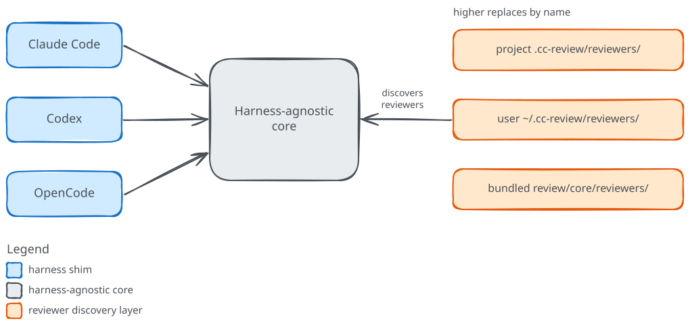

# Extending cc-review

<!-- Sources:
cc-review:README.md:329-351
cc-review:README.md:352-362
cc-review:review/core/scripts/discover-reviewers.sh:717-778
cc-review:review/.claude-plugin/plugin.json:1-20
cc-review:review/.codex-plugin/plugin.json:1-11
-->

cc-review ships with a panel of reviewers, and the panel is open. This section is for the Plugin author who wants to add to it: a reviewer that reads your changed files and reports findings in an area you care about, a wrapper around an external review tool so its output lands in the same merged report, or a change to which reviewers run and which ones you trust. Each of these is a small, local addition, because the core discovers reviewers on every run rather than holding a fixed list.

## How the pieces fit

cc-review keeps the review logic in one place and wires it into each harness separately. The `review/` directory is a single distributable that holds a harness-agnostic core alongside a native manifest for each of the three harnesses it supports: Claude Code, Codex, and OpenCode. Every harness reads its own manifest and reaches the same core. A thin command shim resolves the core directory at run time and delegates to the shared command files, and it adds no review logic of its own, so what you build to extend cc-review lives in the core, not in any one harness.

A reviewer is the unit you add, and the core carries no built-in list of them. On every run, `discover-reviewers.sh` scans three directories for reviewers and emits the set to dispatch. It reads the project layer `.cc-review/reviewers/` in the checkout under review, the user layer `~/.cc-review/reviewers/` in your home directory, and the bundled layer that ships inside the core. The layers have a fixed precedence, project over user over bundled, and a higher layer replaces a lower one of the same name. That is how a reviewer you write takes its place next to the built-in panel, and how a project or user reviewer can stand in for a bundled one by reusing its name.

The pages, in reading order:

- [Write a prompt reviewer](prompt-reviewer.md) builds the simplest reviewer, one Markdown file with a short frontmatter block and a prompt body, and runs it alongside the built-ins.
- [Write a command reviewer](command-reviewer.md) wraps an external command-line tool so its output becomes cc-review findings, walking through the bundled Greptile reviewer field by field.
- [Trust and configuration](trust-and-config.md) covers the trust model that stops a change from steering its own review, and how you turn reviewers on and off in config and for a single run.
