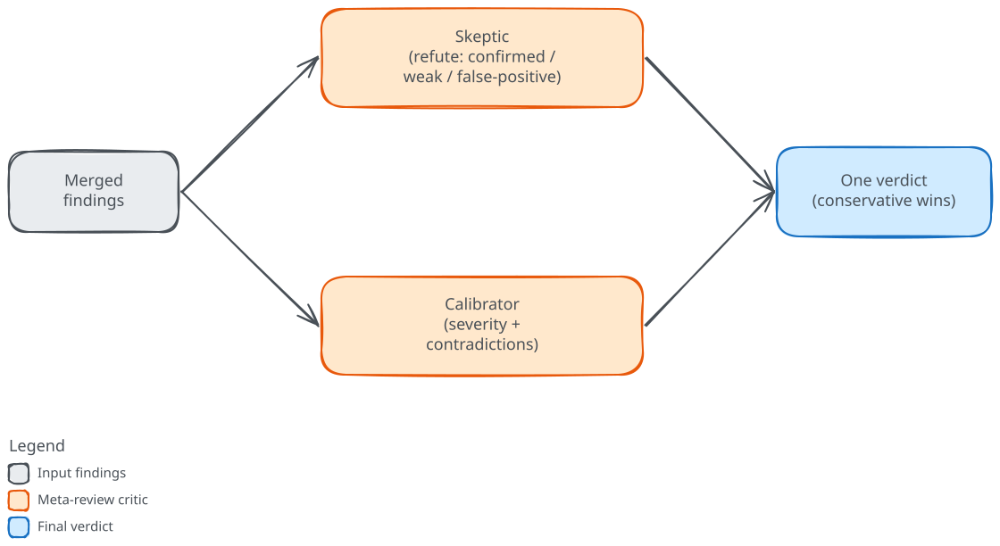

# Meta-review

<!-- Sources:
cc-review:review/core/agents/meta-skeptic.md:17-48
cc-review:review/core/agents/meta-skeptic.md:59-60
cc-review:review/core/agents/meta-skeptic.md:85-87
cc-review:review/core/agents/meta-calibrator.md:17-25
cc-review:review/core/agents/meta-calibrator.md:34-49
cc-review:review/core/agents/meta-calibrator.md:51-70
cc-review:review/core/agents/meta-calibrator.md:72-89
cc-review:review/core/commands/review.md:784-792
cc-review:review/core/commands/review.md:795-819
cc-review:review/core/commands/review.md:851-866
cc-review:review/core/commands/review.md:868-895
cc-review:review/core/commands/review.md:901-913
-->

Once the panel's findings are merged into one list, two critics read that list before cc-review acts on any of it. The first decides whether each finding is real. The second decides whether its severity is right and whether the reviewers contradict one another. Both run at the same time over the same input, and cc-review combines their separate judgments into one outcome for every finding.

## One de-duplicated list

The critics do not judge every raw finding. Before they run, cc-review merges the findings from all reviewers and removes the duplicates. When two findings sit on the same file, cover overlapping lines, and share a category, cc-review folds them together. It keeps the one with the longer description, records the other reviewer in the finding's `also_reported_by` field, and takes the higher of the two severities and the higher confidence. A reviewer marked as isolated is held out of this cross-category step, so a specialized lane keeps its own count. That clean list is what both critics evaluate.

## The Skeptic

The Skeptic asks one question of every finding: is it real? It reads the code each finding points at and tries to refute it, looking for a guard the original reviewer missed, documented behavior that makes the finding moot, or a plain misreading of the code. Its stance is adversarial by design. It assumes a finding is wrong until the code proves it right.

Each finding comes back with one of three verdicts. It is **confirmed** when the code clearly shows the issue and nothing refutes it, and **weak** when the problem is plausible but the evidence does not support the claimed severity. It is a **false positive** when the code does not have the described issue at all. The bar for a false positive is deliberately high. The Skeptic may call a finding a false positive only when it can cite the specific code that disproves it, and it is told not to mark findings false just to shrink the list. When it cannot evaluate a finding at all, it keeps the finding and marks it confirmed, erring on the side of caution. The effect of these rules is that the Skeptic removes few findings outright. Most of what it does is label, not delete.

The Skeptic does not touch severity, contradictions, or reviewer scores. Those belong to the Calibrator.

## The Calibrator

The Calibrator takes the same list and judges proportion rather than truth. For each finding it checks whether the claimed severity matches the evidence, against fixed definitions.

- **Critical** for data loss, a security breach, or a crash or silent corruption on a normally reachable path.
- **Important** for incorrect behavior or reliability problems that need specific but plausible conditions.
- **Minor** for a code-quality concern unlikely to reach a user.
- **Notable** for an observation about design rather than a defect.

When a severity is out of proportion, the Calibrator records a corrected level together with the code evidence behind it.

It then scans across reviewers for contradictions: two findings on the same stretch of code, from different reviewers, that make opposing claims. One says a value can be null while another says it is always set; one flags a race condition while another asserts thread safety. Two findings about different aspects of the same code, one about naming and one about logic, are not a contradiction.

Finally, the Calibrator scores each reviewer on the quality of its findings, estimating a precision, a signal-to-noise ratio, and the count it produced. Those scores are what let the report tell you which lanes were pulling their weight on this change.

## When the two disagree, the stricter call wins

cc-review dispatches the Skeptic and the Calibrator as two subagents in the same step, so they run in parallel and reach their judgments independently. Because the two look at different things, those judgments can diverge, and cc-review combines them in a fixed order. It first drops every finding the Skeptic called a false positive, then records the verdict on each finding that remains, then applies the Calibrator's corrected severities.

Where the two conflict, the more conservative outcome wins. When the Skeptic confirms a finding but the Calibrator downgrades its severity, the downgrade stands. A finding the Skeptic marked weak drops as well, to the Calibrator's level or, when there is none, by a single step with Minor as the floor. cc-review annotates contradictions on the findings rather than resolving them, so a reader can see where the reviewers disagreed.

If either critic fails or times out, cc-review skips the whole stage and lets every finding through unchanged rather than dropping the run.

## Why it waits for enough findings

Meta-review is gated. It runs only when it is enabled, which it is by default, and when the merged list reaches a minimum count, five findings by default. A smaller run skips the critics and goes straight to the [gate](gate-and-fix.md). The threshold matches what the critics are for. Refuting, re-scoring, and cross-checking a handful of findings costs two extra subagents and buys little, while the same work over a long, noisy list is where it earns its place. The [review pipeline](pipeline.md) page shows where this stage sits in a full run.
