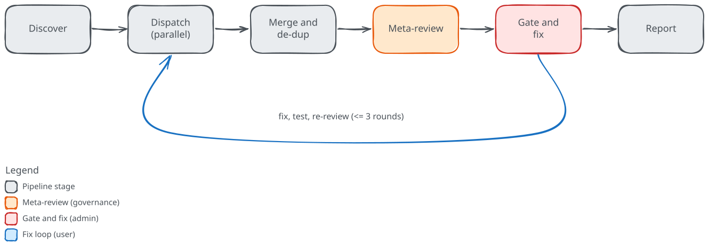

# The review pipeline

<!-- Sources:
cc-review:review/core/commands/review.md:226-353
cc-review:review/core/commands/review.md:632-770
cc-review:review/core/commands/review.md:784-792
cc-review:review/core/commands/review.md:793-914
cc-review:review/core/commands/review.md:916-1050
cc-review:review/core/commands/review.md:1051-1138
-->

One review run carries a set of changes through six stages: discover, dispatch, merge, meta-review, gate and fix, and report. Each stage has a single job and hands its output to the next. The diagram below shows the order, with the fix loop as the one arrow that goes back.

## Discover

cc-review carries no built-in list of reviewers. Every run begins by discovering them from three layers: your project's `.cc-review/reviewers/`, your personal `~/.cc-review/reviewers/`, and the reviewers bundled with the plugin. Everything the run dispatches comes from this discovery output.

Each discovered reviewer is one of two kinds, `prompt` or `command`, and arrives with a status. Enablement then settles which reviewers will run. A reviewer is on or off according to its `reviewers.<name>` key in the merged configuration, or its own default when the configuration says nothing about it. Command-line flags override the configuration: `--only` narrows the run to a named set, `--no-<name>` drops one, and `--external` turns the external tools on or off as a group.

For the command reviewers that are still enabled, cc-review runs a short detection probe, bounded to 15 seconds by default, to confirm the tool is installed and authenticated. A reviewer that is off, cannot run, or fails its probe is marked accordingly and costs the run nothing further. What survives discovery is the ready set.

## Dispatch

The ready set splits by kind. The two kinds run in different ways, but at the same time.

A **prompt reviewer** is a review agent written as a prompt. cc-review dispatches each one as a separate subagent with a fresh context, so no reviewer sees another reviewer's findings or the orchestrator's state. The subagents run in parallel, read the changed files themselves, and return their structured findings through the `ReportFindings` tool, with their final text as a short summary. Keeping each reviewer in its own context also keeps the orchestrator's context small: it holds the findings, not the full contents of every file each reviewer read.

A **command reviewer** is an external command-line review tool. cc-review runs each one as a background process inside the tree under review, bounded by its own timeout, and reads the output it prints. Starting them all in the background and then waiting means the run costs the time of the slowest tool rather than the sum of every timeout. cc-review parses each tool's output into the same finding shape the prompt reviewers use.

A reviewer that errors, times out, or returns nothing cc-review can parse is marked as failed. It never blocks the run; the remaining reviewers still report.

## Merge and de-duplicate

cc-review collects the findings from every reviewer that completed, prompt and command alike, and normalizes them into one shape. Each reviewer's own severity labels are translated into cc-review's severities once, at this point.

The merged findings are sorted by file and line, then de-duplicated. When two findings sit on the same file, cover overlapping lines, and share a category, cc-review keeps the fuller description, records the other reviewer under "also reported by", and takes the higher severity and confidence. Findings from a reviewer marked as isolated stay out of cross-category de-duplication, so a specialized lane keeps its own count. Each surviving finding gets a sequential id.

## Meta-review

Two critics read the merged findings and judge them before anything is acted on. This stage runs only when it is enabled and when the finding count reaches the configured threshold, five by default; a smaller run goes straight to the gate.

The **Skeptic** decides whether each finding is real, marking it confirmed, weak, or a false positive. The **Calibrator** sets the right severity, flags findings that contradict each other, and scores each reviewer. cc-review dispatches both as subagents in parallel, removes the false positives, applies the verdicts and calibrated severities, and annotates the contradictions. When the Skeptic and the Calibrator disagree, the more conservative outcome wins. If either critic fails, cc-review skips the meta-review and lets every finding through unchanged rather than dropping the run.

The [meta-review page](meta-review.md) covers the two critics in detail.

## Gate and fix

The gate is a single decision: how many findings are Critical or Important. Zero is a pass. A count above zero fails the gate, unless the fix loop clears it. Notable findings never count toward the gate.

The fix loop runs when you ask for fixes. In each round, cc-review applies the suggested fixes, runs the test suite when it finds one, and re-dispatches the same reviewers on only the files it changed, then checks the gate again. A failing test becomes a Critical finding of its own. The loop runs up to a configured number of rounds, three by default, or stops early once the gate passes.

The [gate and fix page](gate-and-fix.md) covers the loop and its options.

## Report

Whatever the gate decides, the run ends by writing one findings report. It is written for someone who did not watch the run. The report opens with a summary of how many findings were found, fixed, and left per severity, then lists each finding: where it is, what is wrong, why it matters, and how it was resolved. When the meta-review ran, the report also carries its per-reviewer scores and the findings it removed.
